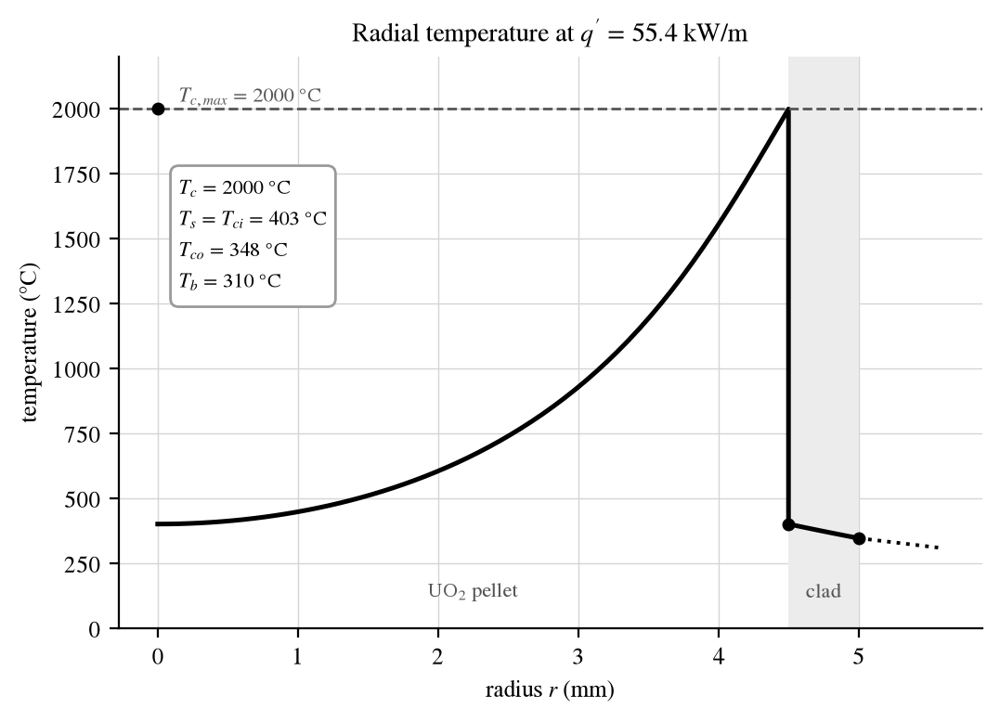
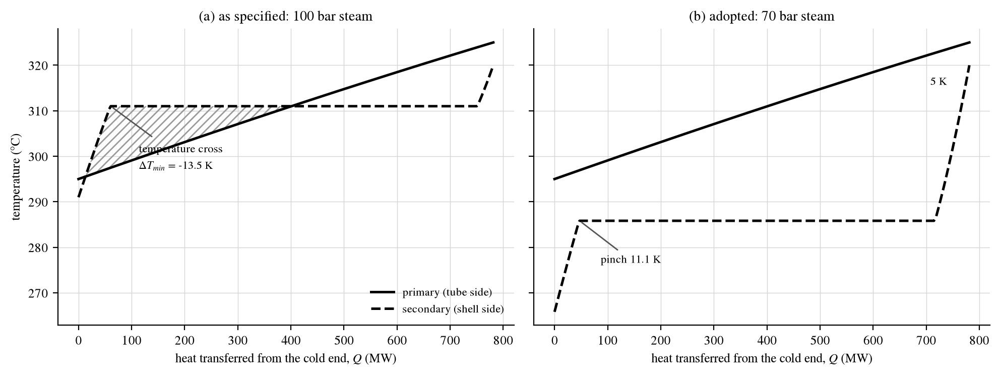
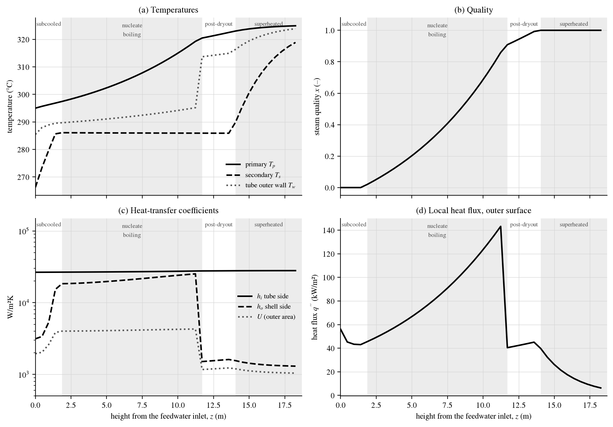
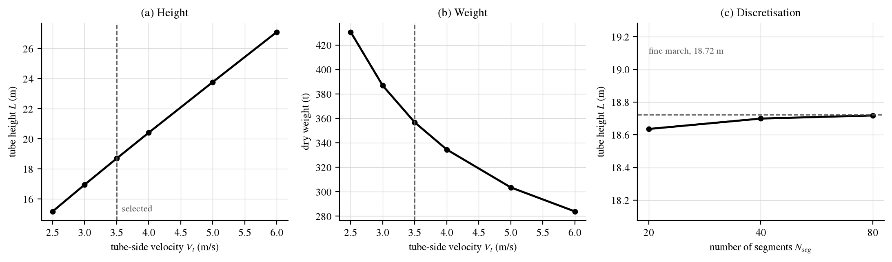

# Reactor thermal hydraulics

Two pressurised-water-reactor (PWR) thermal-hydraulic design calculations in Python, with water
and steam properties from the IAPWS-IF97 steam tables:

1. **Fuel rod:** the maximum permissible linear heat rate of a UO₂ fuel rod (analytical).
2. **Steam generator:** a segment-by-segment design of a once-through steam generator (OTSG).

Each has a Python module, a notebook that walks through the calculation, a derivation or
assumption note, and pytest checks.

| | Notebook |
|---|---|
| Q1 — fuel-rod linear heat-rate limit | [](https://colab.research.google.com/github/mohammedr3za/reactor-thermal-hydraulics/blob/main/notebooks/Q1_fuel_rod_heat_rate.ipynb) |
| Q2 — once-through steam generator design | [](https://colab.research.google.com/github/mohammedr3za/reactor-thermal-hydraulics/blob/main/notebooks/Q2_once_through_steam_generator.ipynb) |

## Q1 — maximum permissible linear heat rate

**Problem.** A PWR rod with a 10 mm outer diameter, a 9 mm UO₂ pellet and a 0.5 mm Zircaloy clad
(no gap: the pellet fills the clad), on a 12.5 mm triangular pitch, cooled by water at 310 °C,
180 bar and 5 m/s. Limits: pellet centre below 2000 °C, clad below 1200 °C.

**Method.** A thermal-resistance chain per metre of rod: coolant film → Zircaloy clad → UO₂
pellet. Weisman's rod-bundle correlation for the film, MATPRO Zircaloy conductivity, and the Fink
(2000) UO₂ conductivity integral instead of a constant conductivity. Derivation:
[`notes/Q1_derivation.md`](notes/Q1_derivation.md).

| Limit | Linear heat rate (kW/m) |
|---|---|
| Pellet centre < 2000 °C | **55.4** (binding) |
| Clad < 1200 °C | 668 |

- At 55 kW/m: clad outer surface 348 °C (9 K below saturation, so single-phase), clad inner
  403 °C, pellet centre 2000 °C.
- The pellet carries 94 % of the temperature drop, so the answer barely depends on the film
  correlation or the coolant temperature (±1–2 %).
- A pellet–clad gap conductance of 5 000–10 000 W/m²K would cut the limit to 41–47 kW/m.
- The plant's core-average linear heat rate is 11.4 kW/m, so the limit allows a total peaking
  factor of 4.9.



## Q2 — once-through steam generator

**Problem.** One of the four steam generators of a 1000 MWe, 32 %-efficient PWR (781.25 MW
thermal each). Primary water flows down inside the tubes from 325 °C to 295 °C at 180 bar.
Feedwater enters the shell side 20 K subcooled and leaves as superheated steam at 320 °C. Tubes
and shell are SS316.

**The specification as written is infeasible.** At the specified 100 bar the steam boils at
311 °C, but the primary leaves at 295 °C, so the temperature–duty profiles cross (minimum
approach −13.5 K): no heat exchanger of any type can meet it. The design keeps every primary-side
number, the 320 °C outlet and the 20 K subcooling, and lowers the steam pressure to **70 bar**,
the largest round value with at least a 10 K pinch at the onset of boiling.
`sg_design.alternatives()` tabulates the other ways out.



**Design** (vertical OTSG, primary in the tubes, feedwater rising on the shell side):

| Quantity | Result |
|---|---|
| Tubes | 14,094 (5/8 in OD, 3.5 m/s tube-side velocity) |
| Tube ID / wall / height | 12.93 mm / 1.473 mm (BWG 17) / 18.7 m |
| Shell ID / wall | 2.72 m / 95 mm |
| Pressure drop, shell / tube | 0.40 bar / 0.94 bar (irreversible) |
| Unladen weight | 357 t |

Flow regions from the bottom: subcooled 0–1.9 m, nucleate boiling 1.9–11.7 m, post-dryout
11.7–14.0 m, superheated 14.0–18.7 m.

**Method.** The code marches upward in 40 equal segments from the cold end, where both streams
are known, so no shooting is needed; the primary reaching 325 °C at the top is the closure check.
Segments are sub-stepped where the flow regime changes. Correlations: Dittus–Boelter
(single-phase), Chen (nucleate boiling), Dougall–Rohsenow (post-dryout), Filonenko friction,
homogeneous two-phase pressure drop, and ASME VIII thin-wall sizing. Every assumption is listed in
[`notes/Q2_assumptions.md`](notes/Q2_assumptions.md).




## Quick start

**In the browser, no install:** click a Colab badge above, then *Runtime → Run all*. The first
cell installs the `iapws` steam-table package.

**Locally:**

```bash
git clone https://github.com/mohammedr3za/reactor-thermal-hydraulics.git
cd reactor-thermal-hydraulics
python3 -m venv .venv && source .venv/bin/activate
pip install -r requirements.txt

python3 -m pytest src/ -q          # 26 checks, a few seconds
python3 src/fuel_rod.py            # Q1 results
python3 src/sg_design.py           # Q2 design at 70 bar
python3 src/sg_design.py 100       # the specified 100 bar: stops with the infeasibility error
jupyter lab notebooks/             # step-by-step notebooks
```

**Executed notebooks and a Word report:**

```bash
python3 src/run_notebooks.py       # executed notebooks + figures in results/ (under a minute)
python3 src/build_report.py        # results/report.docx (about 2 min; needs pandoc)
```

`build_report.py` uses [pandoc](https://pandoc.org/installing.html) to get real Word equations.

## Repository layout

| Path | Content |
|---|---|
| `src/fuel_rod.py` | Q1: `solve_fuel_rod()`, temperatures, radial profile, sensitivities |
| `src/sg_design.py` | Q2: energy balance, pinch analysis, correlations, axial march, `design()`, sweeps |
| `src/plots.py`, `src/flowchart.py` | Figures (black and white) and the flow chart of the Q2 calculation |
| `src/test_*.py` | pytest checks: property values, correlation limits, energy closure, convergence |
| `src/make_notebooks.py` | Builds `notebooks/` from the modules |
| `src/run_notebooks.py`, `src/build_report.py` | Executed notebooks and the Word report, into `results/` |
| `notes/` | Q1 derivation and Q2 assumptions |

The notebooks are **generated** from the modules (split at `# %%` markers). To change a
calculation, edit the module and run `python3 src/make_notebooks.py`; don't edit the notebooks by
hand.

## Adapting it

- **Fuel rod:** edit `ROD` in `src/fuel_rod.py` (geometry, coolant state, temperature limits).
- **Steam generator:** `SPEC_GIVEN` in `src/sg_design.py` holds the plant and steam specification,
  and `DESIGN` holds every design choice (tube size, pitch, velocity, fouling, dryout quality,
  material). For example, `design(dict(SPEC_GIVEN, P_steam_bar=60.0), DESIGN)` redesigns for
  60 bar steam.
- `tradeoff()` sweeps the tube-side velocity and `convergence()` checks the segment count.

## License

MIT — see [LICENSE](LICENSE).
